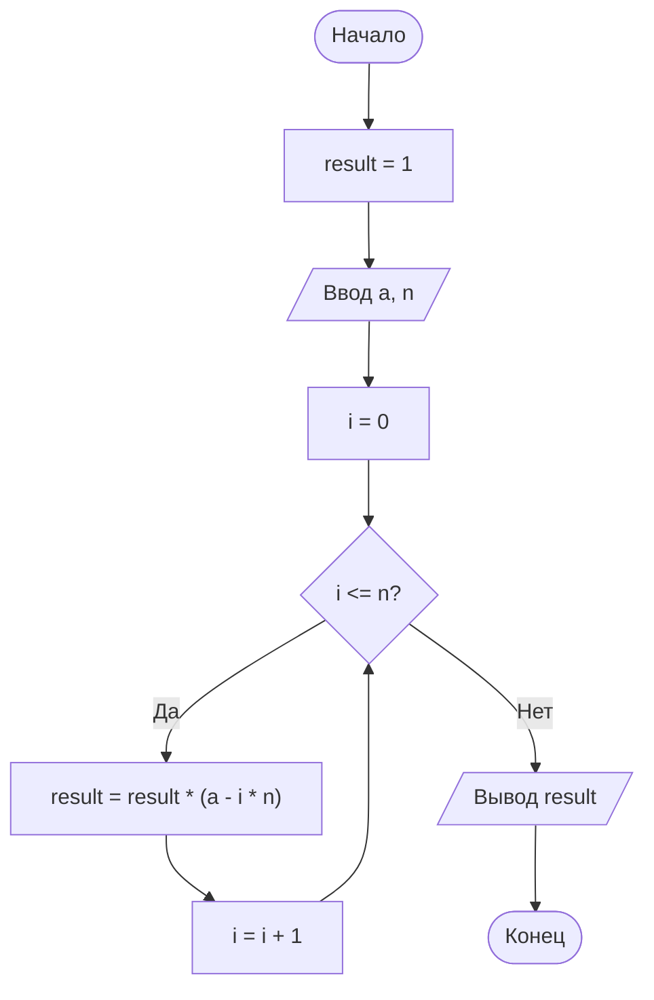

# Задание 6. Вычисление произведения с помощью цикла for

## Условие задачи

Вычислите с использованием цикла `for` значение ряда для заданных пользователем
значений a и n:

$$a(a - n)(a - 2n)\ldots(a - n^2)$$

---

## 1. Идея решения

Выражение — это произведение множителей вида `a - i·n`, где `i` последовательно
принимает значения 0, 1, 2, …, n:

| i | 0 | 1 | 2 | … | n |
|---|---|---|---|---|---|
| множитель | a | a − n | a − 2n | … | a − n·n = a − n² |

Всего получается `n + 1` множитель. Последний множитель `a - n·n` — это как раз `a - n²`
из условия.

Так как перемножаем, начальное значение результата равно 1 (нейтральный элемент
умножения), а на каждом шаге цикла результат умножается на очередной множитель:

```
result = result * (a - i * n)
```

Пример для a = 10, n = 2: i = 0, 1, 2, множители 10, 8, 6, результат 10 · 8 · 6 = 480.

---

## 2. Алгоритм и блок-схема

### Алгоритм

1. Объявить переменные: `a` (тип `double`), `n` и `i` (тип `int`), `result` (тип `double`, начальное значение 1).
2. Запросить и считать `a` и `n`.
3. Выполнить цикл `for` для `i` от 0 до `n` включительно: `result = result * (a - i * n)`.
4. Вывести значение `result`.
5. Завершить программу.

### Блок-схема



---

## 3. Реализация программы

Исходный код находится в файле [series.c](series.c).

---

## 4. Результаты работы программы

Пример 1 — a = 10, n = 2 (множители 10, 8, 6):

```
Введите a: 10
Введите n: 2
Значение выражения a(a - n)(a - 2n)...(a - n^2) = 480.00
```

Пример 2 — a = 10, n = 3 (множители 10, 7, 4, 1):

```
Введите a: 10
Введите n: 3
Значение выражения a(a - n)(a - 2n)...(a - n^2) = 280.00
```

Пример 3 — a = 5, n = 1 (множители 5, 4):

```
Введите a: 5
Введите n: 1
Значение выражения a(a - n)(a - 2n)...(a - n^2) = 20.00
```

Если среди множителей встречается 0 (например, a = 4, n = 2: множители 4, 2, 0), всё произведение равно 0.

---

## 5. Информация о разработчике

- **ФИО:** Воротников Дмитрий Романович
- **Группа:** бОТИ-261
